<div align="center">

# GÖKSYSTEM 3.0

**Industrial SCADA and 3D digital twin of a small plant: a 10 Hz physics simulation, ISA-18.2 alarm handling,
a PLC ladder runtime, and a KiCad-designed field card for every asset.**

[](https://github.com/sycore35/GOKSYSTEM-3.0/actions/workflows/ci.yml)


[](https://www.linkedin.com/in/%C3%B6mer-i%C5%9Fcan-9a64b52b6/)

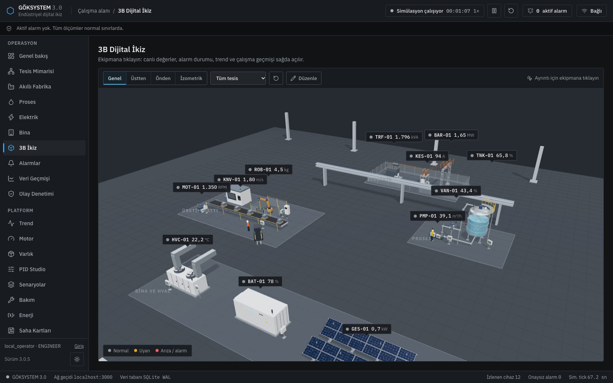

</div>

GÖKSYSTEM simulates four plant areas — a production line, a chemical process loop, an 11 kV substation and a
building with solar and battery storage — and runs them the way a real control system would: field sensors and
actuators are wired to PLC cards, the cards talk Modbus to a SCADA server, and operators work from an HMI with
alarms, trends, an audit trail and a 3D twin that moves with the live data. The operator interface is in Turkish.

## Highlights

- **Physics at 10 Hz** — conveyor with VFD and emergency braking, transformer thermal model with ANSI 49/50
  protection, tank level (Torricelli) with a PID pH loop, building HVAC with PV and battery. Fixed seed and
  scheduled fault scenarios make every run reproducible. Equations are in [`docs/ENGINEERING_MODELS.md`](docs/ENGINEERING_MODELS.md).
- **Live 3D twin** — products move at the measured belt speed, the robot follows its joint angles, the tank fills
  to the measured level, the valve stem tracks its position, breaker contacts open on a trip and transformer fans
  start with oil temperature. Click any machine for live values, alarms, trend, health score and run history.
- **A field card per asset** — 12 GK-P1 PLC cards and 3 GK-S1 smart retrofit cards, each a separate KiCad 10
  design (0 DRC errors), each running its own ladder program every tick. See [`hardware/`](hardware/README.md).
- **Communication diagram** — Purdue-style view from sensors to historian, with the real protocol written on every link.
- **Alarm management** — ISA-18.2 state machine (unacknowledged, acknowledged, return-to-normal, shelved) with
  priorities, deadband, shelving with reason and a full transition history.
- **Protocols** — Modbus TCP server, MQTT topics, an OPC UA node model and a Factory I/O bridge.
- **Measured, not assumed** — tick jitter, overruns, fault isolation and determinism are profiled in the app and
  documented in [`docs/TIMING.md`](docs/TIMING.md).

## Screenshots

| Production line | Process loop |
|:---:|:---:|
| 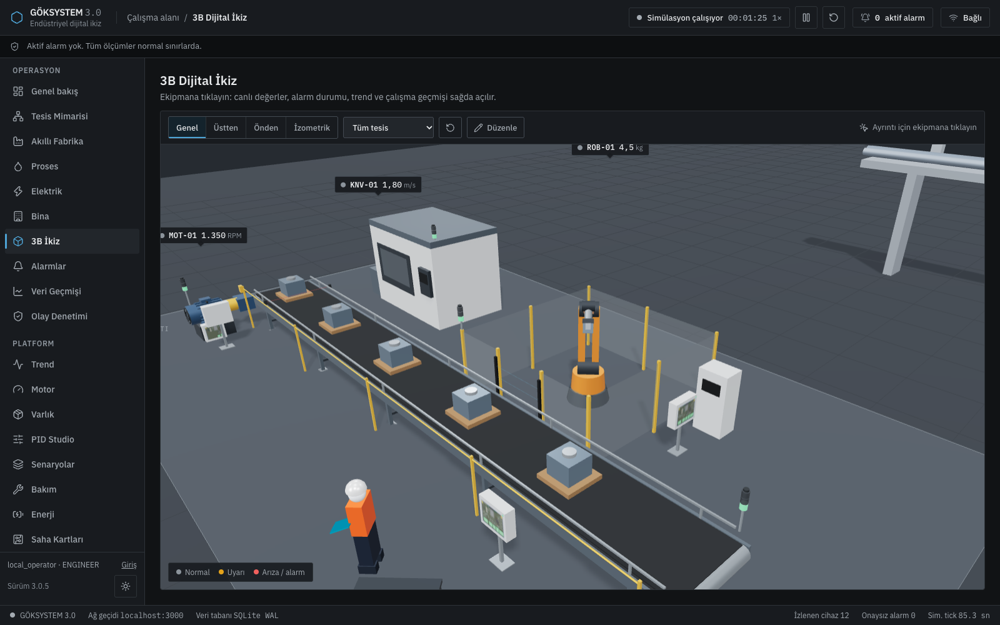 | 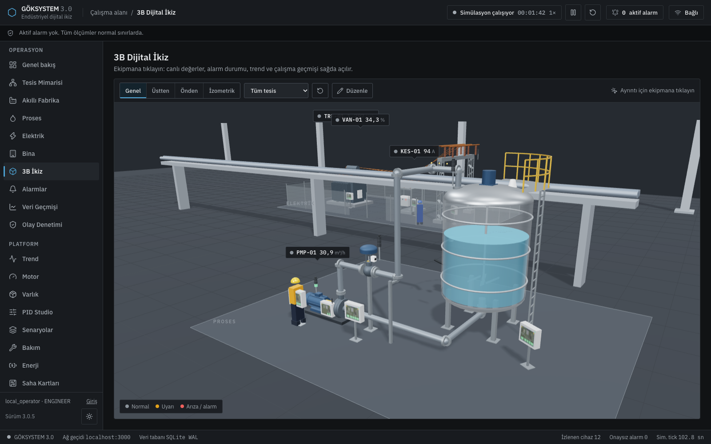 |
| **Substation** | **Click-to-inspect** |
| 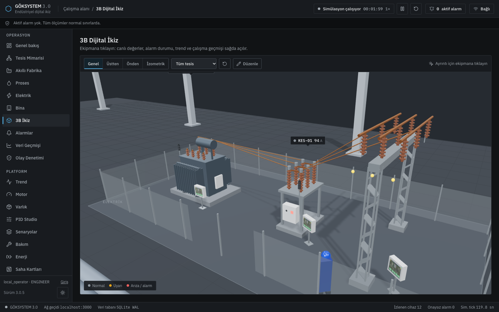 | 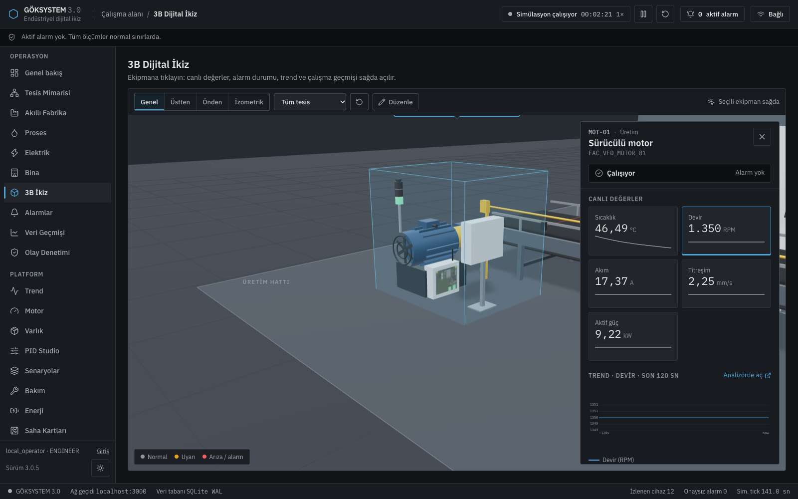 |
| **Alarm center during a fault scenario** | **Plant overview** |
| 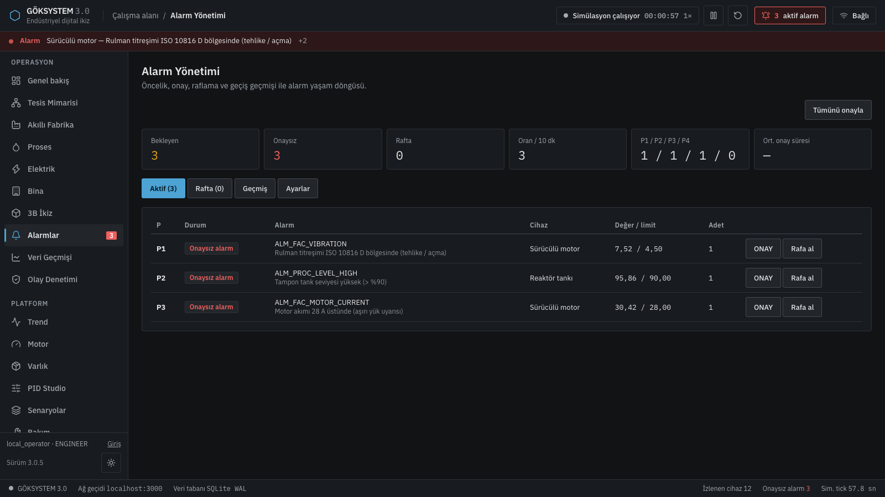 | 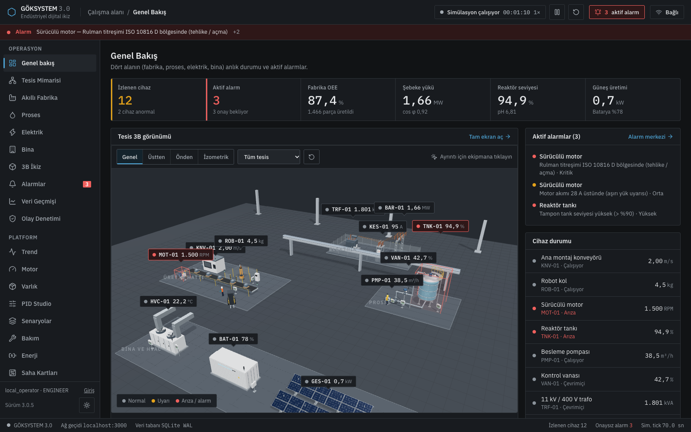 |

### Communication diagram

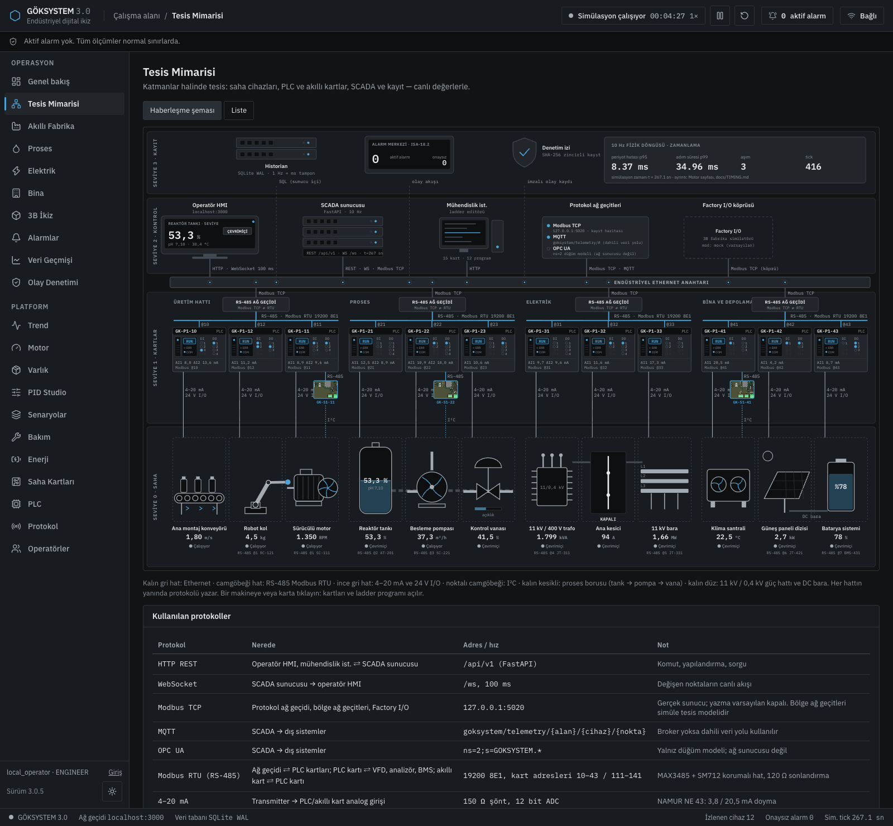

### Field cards

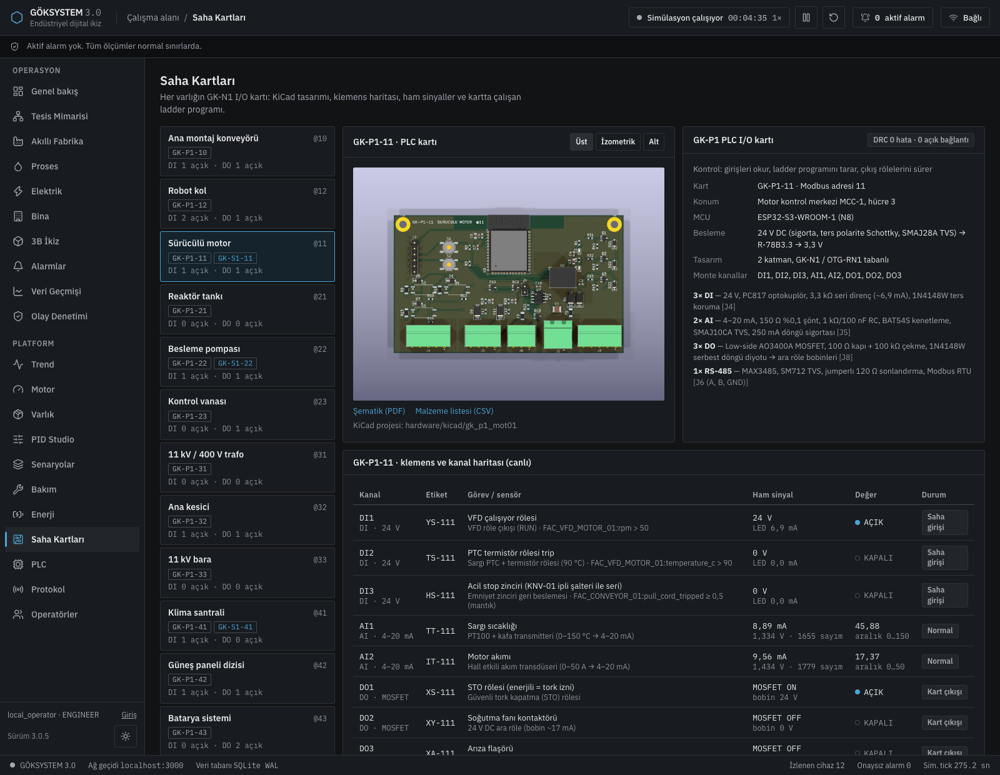

<table>
<tr>
<td>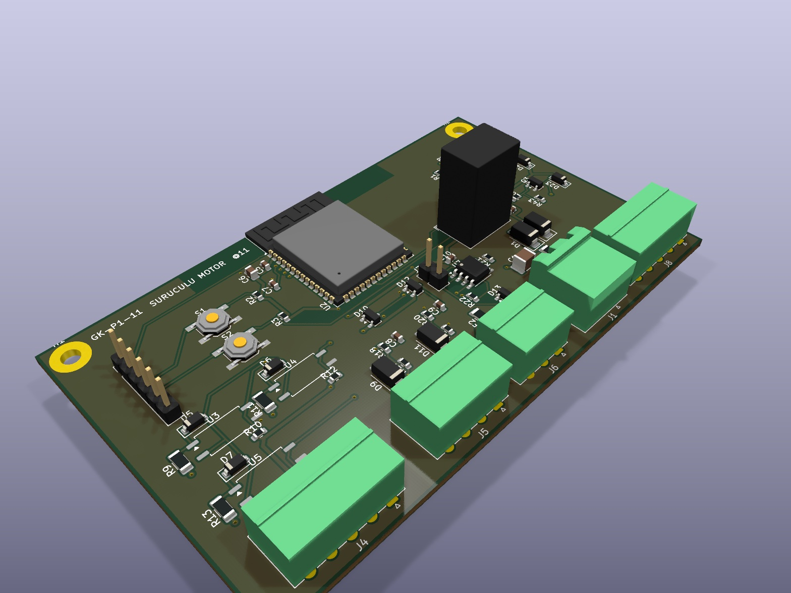</td>
<td>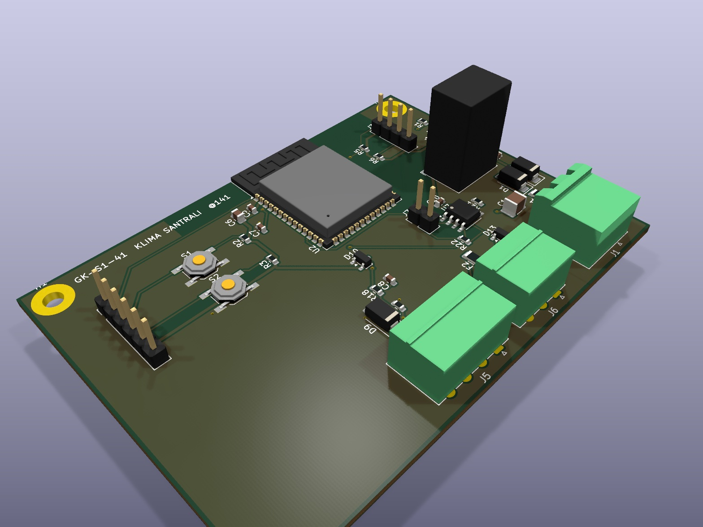</td>
</tr>
<tr>
<td align="center"><b>GK-P1-11</b> · motor PLC card — 3 DI, 2 × 4–20 mA, 3 MOSFET outputs, RS-485</td>
<td align="center"><b>GK-S1-41</b> · HVAC smart card — I²C climate sensor, CO₂ loop input, RS-485</td>
</tr>
</table>

## Architecture

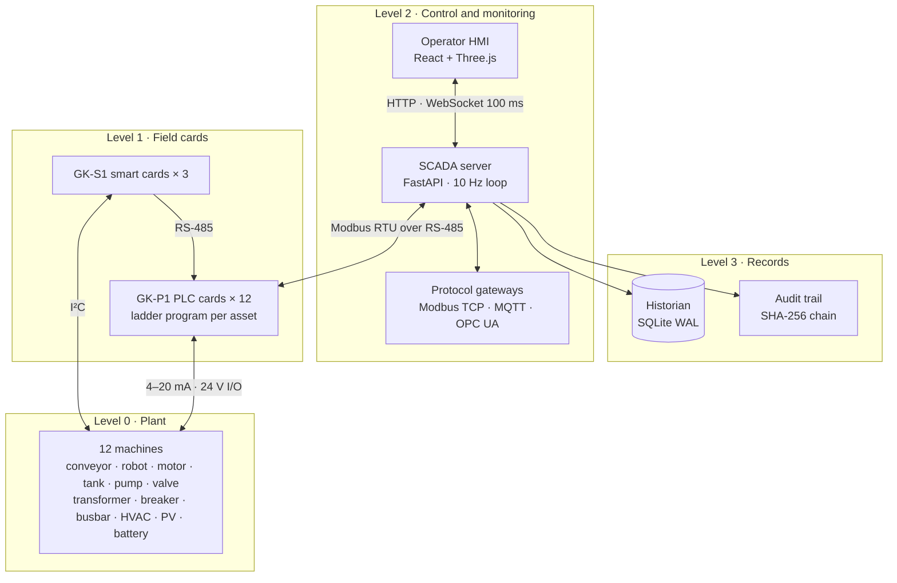

| Protocol | Where | Details |
|---|---|---|
| HTTP REST | HMI ⇄ SCADA server | `/api/v1`, OpenAPI docs at `/docs` |
| WebSocket | SCADA server → HMI | `/ws`, changed points every 100 ms |
| Modbus TCP | protocol simulator, Factory I/O bridge | real server on `127.0.0.1:5020`, writes disabled by default |
| MQTT | SCADA → external systems | `goksystem/telemetry/{area}/{device}/{point}`; in-memory bus when no broker is reachable |
| OPC UA | SCADA → external systems | node model `ns=2;s=GOKSYSTEM.*` (not a network server yet) |
| Modbus RTU | gateways ⇄ cards, cards ⇄ drives / analyzers / BMS | RS-485, 19200 8E1 |
| 4–20 mA, 24 V I/O, I²C | sensors and actuators ⇄ cards | NAMUR NE 43 limits, opto inputs, MOSFET outputs |

More detail in [`docs/ARCHITECTURE.md`](docs/ARCHITECTURE.md) and [`docs/PROTOCOLS.md`](docs/PROTOCOLS.md).

## Getting started

Requires Python 3.10+ and Node.js 18+.

```bash
python3 -m venv .venv
.venv/bin/pip install -r requirements.txt
.venv/bin/python -m uvicorn goksystem.main:app --host 127.0.0.1 --port 8000
```

In a second terminal:

```bash
cd frontend
npm install
npm run dev
```

Open http://localhost:3000. Vite proxies `/api` and `/ws` to port 8000.

One-step launchers: `Start-macOS.command` (double-click; builds the UI when needed and serves everything on
port 8000), `start.sh` on Linux and `start.bat` on Windows.

| Variable | Purpose |
|---|---|
| `GOKSYSTEM_DATA_DIR` | where databases are written (default `data/`) |
| `GOKSYSTEM_SEED`, `GOKSYSTEM_NOISE_PCT` | random seed and measurement noise for reproducible runs |
| `GOKSYSTEM_AUTH_REQUIRED` | `1` to require operator login for every change |
| `GOKSYSTEM_MODBUS_SIM_PORT` | Modbus TCP port (default 5020) |
| `GOKSYSTEM_FACTORYIO_MODE` | `mock`, `live` or `off` |
| `GOKSYSTEM_PORT` | port used by the macOS launcher (default 8000) |

## Tests

```bash
.venv/bin/python -m pytest tests          # 105 tests: physics, alarms, protocols, API, PLC, field cards
cd frontend && npx tsc --noEmit && npm run build
```

GitHub Actions runs both on every push and pull request. The wall-clock timing test is skipped on shared CI
runners; run `scripts/measure_tick.py` or `scripts/measure_tick_under_load.py` locally for real numbers.

## Project layout

```
goksystem/
  core/        simulation engine, state container, device registry
  domains/     factory, process, grid and building models
  scada/       alarm engine, security
  historian/   SQLite storage
  protocols/   Modbus TCP, MQTT, OPC UA, Factory I/O
  modules/     PLC runtime, field cards, run history, energy, maintenance, scenarios, ...
  api/         REST routes and WebSocket hub
frontend/      React + Vite + Three.js operator interface
hardware/      KiCad sources of the 15 field cards and the scripts that generate them
docs/          models, architecture, protocols, timing
tests/         pytest suite
desktop/       Electron wrapper; packaging/ holds the PyInstaller entry point
```

## Notes

- This is a simulator for learning and demonstration, not a certified control or safety system. The field cards
  are complete KiCad designs but have not been manufactured or bench-tested.
- Everything binds to localhost; authentication is off unless `GOKSYSTEM_AUTH_REQUIRED=1`.
- The 3D scene is built from procedural meshes; see [`ASSET_CREDITS.md`](ASSET_CREDITS.md).
- Desktop installers are built by `.github/workflows/desktop-packaging.yml` on version tags.

## Author

**Ömer İşcan** — [LinkedIn](https://www.linkedin.com/in/%C3%B6mer-i%C5%9Fcan-9a64b52b6/) · [GitHub](https://github.com/sycore35)
